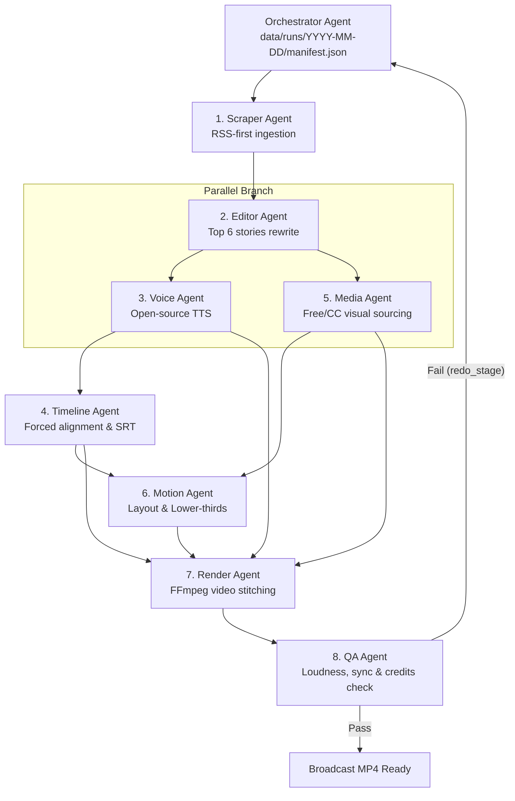

# Nepal News Bot (`nepal-news-bot`)

> Automated multi-agent broadcast news video production pipeline for Nepal news.

`nepal-news-bot` is an autonomous multi-agent system where a central **Orchestrator Agent** coordinates eight specialist agents to fetch daily news from verified Nepali outlets, rewrite them into concise broadcast narration, synthesize speech, extract timestamps, source licensed visuals, compose motion graphics, render high-definition MP4 video, and perform automated quality assurance before publishing.

---

## 1. System Architecture



### Agent Roles

| Agent | Specification | Primary Responsibility | Input Contract | Output Contract |
| :--- | :--- | :--- | :--- | :--- |
| **Orchestrator** | [`agents/orchestrator.md`](agents/orchestrator.md) | Coordinates DAG execution, retries, concurrency, and state tracking | `pipeline.yaml` | `manifest.schema.json` |
| **1. Scraper** | [`agents/scraper.md`](agents/scraper.md) | Ingests RSS feeds from verified outlets with polite throttling | `sources.yaml` | `articles.schema.json` |
| **2. Editor** | [`agents/editor.md`](agents/editor.md) | Deduplicates, selects top 6 stories, rewrites into broadcast narration | `articles.schema.json` | `script.schema.json` |
| **3. Voice** | [`agents/voice.md`](agents/voice.md) | Synthesizes broadcast narration using open-source TTS | `script.schema.json` | `narration.wav` |
| **4. Timeline** | [`agents/timeline.md`](agents/timeline.md) | Computes word-level and scene-level timestamps via forced alignment | `narration.wav`, `script.json` | `timeline.schema.json`, `captions.srt` |
| **5. Media** | [`agents/media.md`](agents/media.md) | Collects licensed visual B-roll (Pexels, Pixabay, Wikimedia, CC) | `script.schema.json` | `media_manifest.schema.json` |
| **6. Motion** | [`agents/motion.md`](agents/motion.md) | Designs lower-thirds, source badges, transitions, and caption styling | `timeline.json`, `media_manifest.json` | `render_plan.schema.json` |
| **7. Render** | [`agents/render.md`](agents/render.md) | Stitches media, audio, captions, and motion elements via FFmpeg | `render_plan.json`, assets | `final.mp4` |
| **8. QA** | [`agents/qa.md`](agents/qa.md) | Pre-publish gatekeeper: sync, loudness, black frames, attribution | `final.mp4`, reference files | `qa_report.schema.json` |

---

## 2. Ground Rules & Doctrine

All agents and modules must strictly adhere to the following laws:

1. **RSS First & Respect Robots.txt**:
   - Always prefer structured RSS/Atom feeds over HTML scraping.
   - Respect `robots.txt` disallow rules and maintain a request delay of at least 2 seconds between HTTP calls.
   - Always identify with user agent `NepalNewsBot/0.1 (personal project)`.

2. **No Verbatim Content / Mandatory Attribution**:
   - Never republish article text verbatim.
   - All news narration is an original rewrite in our own words using broadcast news style.
   - Every individual story scene must prominently display an on-screen lower-third badge crediting the news outlet.

3. **Visual Licensing Integrity**:
   - Visuals must be sourced exclusively from free, open-licensed, or public domain sources (Pexels, Pixabay, Wikimedia Commons, CC-BY, CC0) or our own motion graphics.
   - NEVER scrape, download, or rip photos or footage from news outlets.
   - Any video downloaded via `yt-dlp` must be strictly verified as Creative Commons or Public Domain.
   - Every asset must have its origin URL, license type, and creator attribution logged in `media_manifest.json`.

4. **File-Only Communication & Manifest Sovereignty**:
   - Agents communicate strictly through files and the central `manifest.json`.
   - No hidden in-memory state or shared runtime variables.
   - Every single pipeline stage can be independently resumed or re-run from its declared input files.

---

## 3. Project Structure

```
nepal-news-bot/
├── config/
│   ├── sources.yaml           # Verified news outlets, RSS endpoints, and crawl parameters
│   └── pipeline.yaml          # Execution DAG, parallel groups, retries, timeouts, model stubs
├── agents/                    # Concrete specifications and DoD checklists for each agent
│   ├── orchestrator.md
│   ├── scraper.md
│   ├── editor.md
│   ├── voice.md
│   ├── timeline.md
│   ├── media.md
│   ├── motion.md
│   ├── render.md
│   └── qa.md
├── contracts/                 # Formal JSON Schemas governing all inter-agent handoff files
│   ├── articles.schema.json
│   ├── script.schema.json
│   ├── timeline.schema.json
│   ├── media_manifest.schema.json
│   ├── render_plan.schema.json
│   ├── qa_report.schema.json
│   ├── manifest.schema.json
│   └── manifest.example.json
├── src/
│   ├── __init__.py
│   ├── orchestrator.py        # Central execution engine: loads manifest, loops DAG, retries
│   ├── agents/                # Agent class stubs implementing BaseAgent
│   │   ├── __init__.py
│   │   ├── base.py            # BaseAgent abstract class with contract validation
│   │   ├── scraper.py
│   │   ├── editor.py
│   │   ├── voice.py
│   │   ├── timeline.py
│   │   ├── media.py
│   │   ├── motion.py
│   │   ├── render.py
│   │   └── qa.py
│   └── utils/                 # Utilities for manifest, logging, and schema verification
│       ├── __init__.py
│       ├── logging.py
│       ├── manifest.py
│       └── schema_validate.py
├── data/
│   └── runs/                  # Execution artifacts per date: data/runs/<YYYY-MM-DD>/
├── run_daily.py               # Main CLI entry point
├── requirements.txt           # Python dependencies
├── .gitignore
└── README.md
```

---

## 4. News Sources Verification

Each news candidate was tested directly against its `robots.txt` and RSS/Atom feeds:

| Outlet | Homepage | Feed Endpoint | Entries | Robots.txt Status | Usable Status | Notes |
| :--- | :--- | :--- | :---: | :--- | :---: | :--- |
| **Onlinekhabar English** | `https://english.onlinekhabar.com` | `/feed` | 20 | Allowed (Disallow `/wp-admin/` only) | **YES** | RSS 2.0 with titles, URLs, and pub dates. |
| **The Kathmandu Post** | `https://kathmandupost.com` | `/rss` | 40 | Allowed (Disallow empty) | **YES** | Working feed. Dates parsed from `/YYYY/MM/DD/` URL structure. |
| **Republica** | `https://myrepublica.nagariknetwork.com` | `/feeds` | 30 | Allowed (Disallow empty) | **YES** | Working feed with titles, URLs, and timestamps. |
| **The Himalayan Times** | `https://thehimalayantimes.com` | `/rssFeed/15` | 50 | Allowed (Feeds & articles permitted) | **YES** | Nepal category feed with titles, URLs, and timestamps. |
| **Setopati English** | `https://en.setopati.com` | `/feed` | 0 | Disallows `/login/*`, `/cms/*` | **NO** | Feed endpoint returns HTTP 500 error; disabled for RSS. |

---

## 5. Setup & Usage

### Prerequisites
- Python 3.10+ (Tested on Python 3.13)
- `ffmpeg` installed and available in system PATH

### Installation
```bash
# 1. Clone repository and navigate to directory
cd news-auto

# 2. Create virtual environment
python -m venv .venv

# 3. Activate virtual environment
# Windows:
.\.venv\Scripts\Activate.ps1
# Linux/macOS:
source .venv/bin/activate

# 4. Install dependencies
pip install -r requirements.txt
```

### Initializing a Daily Run
```bash
# Initialize folder and manifest for today without running unfinished stubs:
python run_daily.py --init-only

# Or specify a target date:
python run_daily.py --date 2026-11-06 --init-only
```
